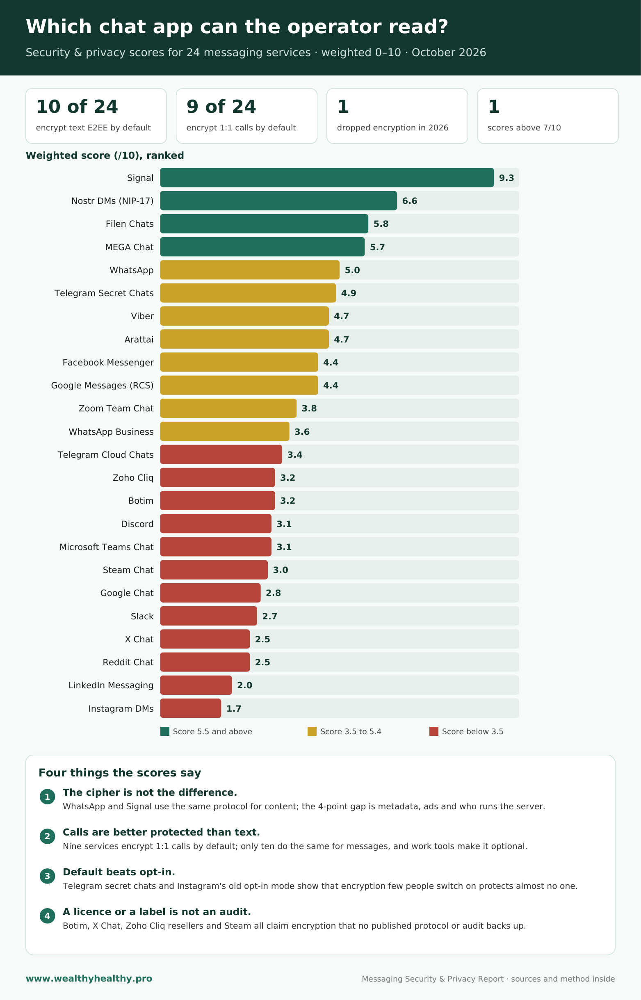

# Messaging Security & Privacy Report: 24 Chat Services Compared

**Report date: 2 October 2026 — Data current to 2 October 2026**

This report compares the security and privacy of WhatsApp, Facebook Messenger, Telegram (cloud chats and secret chats scored separately), Signal and MEGA Chat, plus Viber, Arattai, Botim, X Chat, Google Chat, Nostr direct messages, Google Messages (RCS) and Filen Chats, the direct-message features of Discord, Steam, Reddit, LinkedIn and Instagram and the workplace and business tools Microsoft Teams, Slack, Zoho Cliq, Zoom Team Chat and WhatsApp Business, as of October 2026. It examines encryption design, metadata collection, data sharing, backups, openness, server locations and legal jurisdiction, and the 2024–2026 incident record, then scores each on eight weighted criteria. Signal ranks first at 9.3/10; Telegram cloud chats rank last at 3.4/10.

## At a glance

**Which chat app can the operator read?** Security & privacy scores for 24 messaging services · weighted 0–10 · October 2026.

- **10 of 24** encrypt text E2EE by default
- **9 of 24** encrypt 1:1 calls by default
- **1** dropped encryption in 2026
- **1** scores above 7/10

### Four things the scores say

1. **The cipher is not the difference.** WhatsApp and Signal use the same protocol for content; the 4-point gap is metadata, ads and who runs the server.
2. **Calls are better protected than text.** Nine services encrypt 1:1 calls by default; only ten do the same for messages, and work tools make it optional.
3. **Default beats opt-in.** Telegram secret chats and Instagram's old opt-in mode show that encryption few people switch on protects almost no one.
4. **A licence or a label is not an audit.** Botim, X Chat, Zoho Cliq resellers and Steam all claim encryption that no published protocol or audit backs up.

## Files

| File | Description |
| --- | --- |
| [`Messaging_Security_Privacy_Report_Oct2026.pdf`](Messaging_Security_Privacy_Report_Oct2026.pdf) | Full 30-page report, including methodology, per-service profiles and sources |
| [`Messaging_Privacy_Poster.png`](Messaging_Privacy_Poster.png) | "At a glance" chart: weighted score for all 24 services |

Published by [www.wealthyhealthy.pro](https://www.wealthyhealthy.pro).

---

## AI-generated content disclaimer

This report was generated by Anthropic's Claude Fable 5.1 and Claude Opus models from publicly available sources on 2 October 2026, at the request of the publisher of www.wealthyhealthy.pro. Scores reflect a weighted rubric applied by the models, not independent testing or audits. Facts were drawn from vendor documentation, transparency reports, peer-reviewed research and established security press as cited; pending litigation is reported as allegation only. Services change their encryption, policies and ownership frequently, so verify any detail against the linked primary source before relying on it. This is general information, not legal, security or compliance advice.
